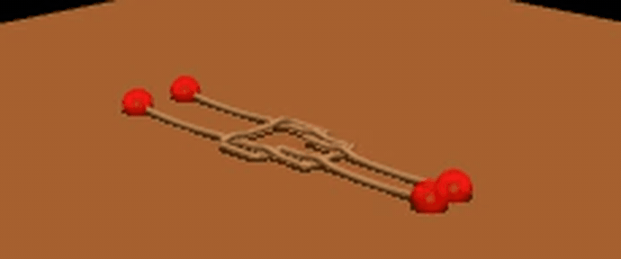
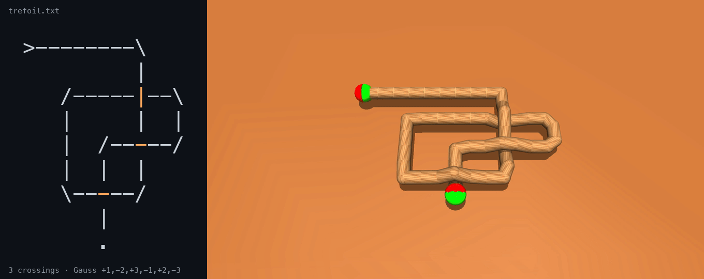
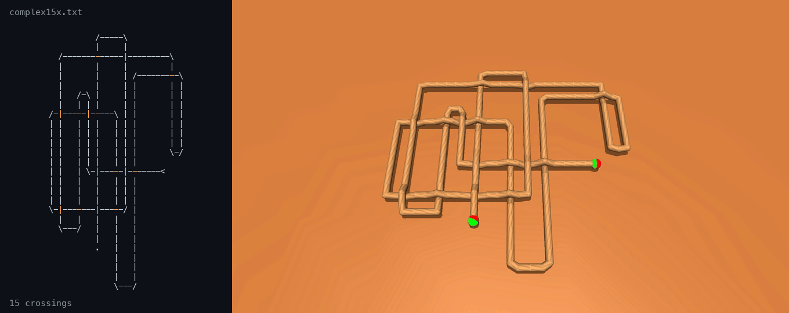
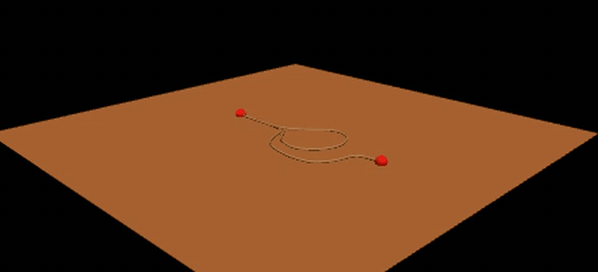

<div align="center">

# BlenderSuperKnot

**Type a knot in ASCII. Get a physically simulated rope that pulls itself tight.**




<sub>Two ropes joined by a reef knot. MuJoCo pulls all four ends and the knot cinches tight. · <a href="docs/media/reef_knot.mp4">MP4</a></sub>

</div>

---

You draw a knot with `-` `|` `/` `\`. The tracer reads the topology straight off the
drawing (Gauss code, crossing signs, knot invariants). Blender turns it into a rope, and
MuJoCo pulls on the ends until the knot goes taut, jams, or slips free. Every run produces
a video, quantitative metrics, and a machine-checked label saying which knot it is.

<table>
<tr>
<td align="center" width="33%"><h2>32,794</h2>distinct knot diagrams from the 4 drawings in the library, one character changed per crossing</td>
<td align="center" width="33%"><h2>≥ 239</h2>distinct knot types among them, each certified by its Alexander polynomial</td>
<td align="center" width="33%"><h2>1 entry</h2>is all it takes to add a knot. Paste a drawing and every stage picks it up</td>
</tr>
</table>

## ASCII in, rope out



This is the entire input for the knot above:

```
>--------\
         |
   /-----|--\
   |     |  |
   |  /-----/
   |  |  |
   \-----/
      |
      .
```

`>` is where the rope starts and `.` is where it ends. At a crossing you draw the strand
that passes **over**, and the interrupted strand goes under (orange in the animation). The
tracer turns this into Gauss code `+1,-2,+3,-1,+2,-3` and checks that its invariants (Fox
colourings, Alexander polynomial 1 − t + t²) match the trefoil's. The rope is then built,
exported to MuJoCo, and pulled by its two ends. It stops on its own once the knot is taut.

## How many knots can you draw?

Every crossing is a one-character switch: change its `-` to `|` and the other strand goes
on top. So a drawing with *n* crossings stands for 2<sup>*n*</sup> different diagrams, and
every one of them traces, builds and simulates with no extra work. Starting from just the
four ASCII drawings in the library:

| drawing | crossings | diagrams | provably knotted | distinct knot types |
|---|---:|---:|---:|---:|
| `curl_r1` | 1 | 2 | 0 | 1 |
| `trefoil` (= `unknot_3x`, same shadow) | 3 | 8 | 2 | 2 |
| `figure_eight` | 4 | 16 | 4 | 3 |
| `complex15x` | 15 | 32,768 | 25,156 | 239 |
| **total** | | **32,794** | **25,162** | **≥ 239** |

Knot type here means the type of the rope's closure, with the two ends joined around
the outside. Two diagrams with different Alexander polynomials are guaranteed to be
different knots, so 239 polynomials is a **certified lower bound**. Mirror images are
counted once, and so are any knots that happen to share a polynomial. "Provably knotted"
means the polynomial is not 1. The most common types inside the 15-crossing drawing:

| Alexander polynomial Δ | diagrams | smallest knot with this Δ |
|---|---:|---|
| 1 | 7,612 | unknot (Δ cannot rule out a Δ-trivial knot) |
| 1 − t + t² | 5,112 | trefoil 3₁ |
| 2 − 3t + 2t² | 3,040 | 5₂ |
| 1 − 2t + 3t² − 2t³ + t⁴ | 1,932 | granny / square knot 3₁ # 3₁ |
| 1 − 3t + t² | 1,624 | figure-eight 4₁ |
| 1 − t + t² − t³ + t⁴ | 1,540 | cinquefoil 5₁ |
| 1 − 3t + 5t² − 3t³ + t⁴ | 1,260 | 6₃ |
| 2 − 5t + 2t² | 712 | stevedore 6₁ |

Some of these knots have Δ spans up to 8, which means genus at least 4. Reproduce the whole
census in about 15 s on a laptop, with no Blender or MuJoCo needed:

```bash
python -m superknot variants --all
```

Beyond the library, the format is complete in principle. Every knot and every link has a
rectilinear (grid) diagram, so any of them can be drawn this way, and the tracer handles
several ropes in one drawing.

## Physical tightening



The same endpoint pull gives very different outcomes depending on the topology, and the
simulator reports which outcome happened instead of just running for a fixed time:

| knot | what happens | stop reason | pulled per end | peak force | arc / chord |
|---|---|---|---:|---:|---:|
| `trefoil` | cinches into a tight overhand knot | `taut` | 0.19 m | 15.0 N | 2.07 |
| `complex15x` | 15 crossings collapse into one hard tangle | `taut` | 0.51 m | 10.9 N | 4.82 |
| `slip_knot` | the curl runs out and the rope comes straight | `taut` | 1.16 m | 12.6 N | **1.00** |

<p align="center">
<br>
<sub>The slip knot is the control case. The same pull that cinches a real knot releases a removable curl.</sub>
</p>

**How it works.** The rope is a chain of capsules joined by ball joints, with self-contact
on and friction on every contact. Each end is welded to a mocap handle that moves outward
along the rope's tangent. The pull stops when the smoothed weld tension stays above a
threshold (`taut`), or when a hard force ceiling trips (`safety_limit`), which means the
rope jammed. *Arc / chord* is rope length over end-to-end distance: 1.0 is a straight
rope, and a big value means a lot of rope is locked inside the knot.

### Finding: pulling the ends does not untie a knot

Shape a trefoil and an unknot so that they have exactly the same shadow and differ only in
the height of one crossing (`right_trefoil` vs `three_crossing_unknot`), then pull both:

| asset | knot type | pulled (m) | peak force (N) | arc / chord | stop reason |
|---|---|---:|---:|---:|---|
| `right_trefoil` | 3₁ | 0.362 | 80.2 | 3.91 | `safety_limit` |
| `three_crossing_unknot` | unknot | 0.368 | 80.2 | 3.89 | `safety_limit` |
| `left_trefoil` | 3₁ mirror | 0.422 | 80.8 | 3.30 | `safety_limit` |
| `right_trefoil_r1` | 3₁, 4-crossing view | 0.242 | 80.7 | 6.45 | `safety_limit` |
| `right_trefoil_r2` | 3₁, 5-crossing view | 0.771 | 80.5 | 1.74 | `safety_limit` |
| `right_trefoil_r3` | 3₁, 3-crossing view | 0.316 | 80.5 | 4.59 | `safety_limit` |

The unknot jams just as hard as the trefoil it shares a shadow with: 0.368 m against 0.362 m
pulled, arc/chord 3.89 against 3.91. Friction and self-contact lock the rope before
topology gets a say. So any claim that a policy "unties knots by pulling the ends" has to
beat this trivial control first. Reproduce it with
`python -m superknot run --family topology_controls`.

## Pipeline

```
 ASCII diagram          Gauss code          Blender curve         MJCF model          MuJoCo
 ┌───────────┐          (labels)           ┌───────────┐        ┌───────────┐      ┌──────────┐
 │ >-------\ │  trace   +1,-2,+3,          │  one POLY │ export │ capsule   │ pull │  video   │
 │  /----|-\ │ ───────► -1,+2,-3   ──────► │  spline   │ ─────► │ chain +   │ ───► │    +     │
 │  \----/   │                             │  per rope │        │ ball jts  │      │ metrics  │
 └───────────┘                             └───────────┘        └───────────┘      └──────────┘
   superknot.ascii_diagram                  blender/build_asset   blender/export_mjcf   sim/tighten
```

The Gauss code is a **label, not an intermediate**. It is derived from the drawing so that
every rope carries a machine-readable description of its topology, but no downstream stage
consumes it. That is deliberate: it lets you ask whether a learned or scripted policy can
tell a trefoil from an unknot *from the physics alone*.

## Quick start

```bash
git clone https://github.com/InvalidCodes/BlenderSuperKnot.git
cd BlenderSuperKnot
pip install -e ".[sim]"                  # MuJoCo stage; Blender 4.0+ must be on PATH

python -m superknot list                 # every knot and every preset
python -m superknot show trefoil         # diagram, Gauss code, invariants (pure Python)
python -m superknot variants --all       # the diversity census above (pure Python)
python -m superknot run trefoil          # build -> export -> simulate
```

The diagram, Gauss-code and invariant layer is plain Python with no dependencies at all:
`pip install -e .` without `[sim]` is enough for `show` and `variants`.

| Output | Stage |
|---|---|
| `build/<name>.blend` | Blender curve with topology metadata |
| `build/<name>.xml` | MJCF model |
| `results/<name>.mp4` | tightening video |
| `results/<name>.json` | metrics: pull distance, peak force, arc/chord, stop reason |

Each stage is its own command and reads the previous stage's file, so a failed run can be
resumed instead of restarted (`build`, `export`, `simulate`). Batch selectors work on
every command: `--family topology_controls`, `--all --preset smoke`. If MuJoCo lives in
another environment, point at it with `--python ~/anaconda3/envs/mujoco/bin/python`.

## Add your own knot

Add one entry to `DIAGRAMS` in
[`superknot/knots/ascii_library.py`](superknot/knots/ascii_library.py):

```python
"my_knot": dict(
    description="What this knot is",
    expected_crossings=3,
    diagram=r"""
>--------\
         |
   /-----|--\
   |     |  |
   |  /-----/
   |  |  |
   \-----/
      |
      .
""",
),
```

From then on it works everywhere: `show`, `variants`, `build`, `export`, `simulate`,
`run`, the test suite, and the Blender add-on's dropdown.

**Drawing rules.** `-` and `|` are straight runs, `/` and `\` are corners. At a crossing,
draw the character of the strand that passes over. Every rope is open, because it needs
two free ends to pull: start it with `>`, `<`, `^` or `V` pointing along the rope, and end
it with `.`. `expected_crossings` is checked against the trace, so a mis-drawn diagram
fails loudly at build time instead of quietly becoming a different knot.

When a character grid is the wrong tool (smooth splines, closed-form curves, rigid
re-projections), add the knot to [`superknot/knots/parametric.py`](superknot/knots/parametric.py)
instead. Both libraries implement the same `Asset` interface.

<details>
<summary><b>Knot library</b></summary>

| Family | Knot | Crossings | Notes |
|---|---|---|---|
| `ascii` | `curl_r1` | 1 | Reidemeister-I curl; pulls straight out |
| | `trefoil` | 3 | alternating; closure is 3₁ |
| | `unknot_3x` | 3 | **same shadow as `trefoil`**, one crossing switched |
| | `figure_eight` | 4 | alternating; closure is 4₁ |
| | `complex15x` | 15 | dense single lead; exporter stress test |
| `slip` | `slip_knot` | 1 | removable curl, released by pulling both ends |
| `topology_controls` | `right_trefoil` | 3 | the base projection |
| | `three_crossing_unknot` | 3 | same shadow, one crossing switched |
| | `left_trefoil` | 3 | every crossing mirrored |
| | `right_trefoil_r1/r2/r3` | 4 / 5 / 3 | rigid rotations of `right_trefoil` |

The library is built around two controlled comparisons. **Same appearance, different
topology:** `trefoil` vs `unknot_3x`, and `right_trefoil` vs `three_crossing_unknot`, share
a projection exactly and differ only in the height of one crossing. **Same topology,
different appearance:** `right_trefoil_r1/r2/r3` are the same curve rigidly rotated so the
projection shows 4, 5 and 3 crossings.

Knot identities are verified, not asserted. Fox *p*-colourings and Alexander polynomials
are computed from the traced Gauss code, and the test suite checks them:

| knot | p=3 | p=5 | Δ | verdict |
|---|---|---|---|---|
| `curl_r1`, `unknot_3x` | 1 | 1 | 1 | trivial |
| `trefoil` | **2** | 1 | 1 − t + t² | 3₁ |
| `figure_eight` | 1 | **2** | 1 − 3t + t² | 4₁ |

</details>

<details>
<summary><b>How each stage works</b></summary>

**1. Diagram → centerline** ([`ascii_diagram.py`](superknot/ascii_diagram.py)). The tracer
walks each strand from a free end using a transition table keyed by
`(character, incoming direction)`. A cell visited twice is a crossing. Crossings are
numbered row-major, and each strand emits `+n`/`-n` as it passes over/under. The crossing
sign comes from the two strands' directions. Cells lift to `(x, -y, ±z_depth/2)` and then
scale to metres. No `bpy` is involved, which is why all of this is testable on a bare
interpreter.

**2. Centerline → Blender** ([`build_asset.py`](superknot/blender/build_asset.py)). Builds
one `POLY` spline per rope in a scene created from scratch, with no template `.blend`
needed. It bevels the spline to the rope radius and stamps the topology metadata onto the
object as custom properties.

**3. Blender → MJCF** ([`export_mjcf.py`](superknot/blender/export_mjcf.py)).
- Resamples the centerline to a uniform arc-length step.
- Emits a nested body chain: a freejoint on the first segment and `ball` joints after that.
- Gives each segment two geoms, an invisible collision capsule and a textured visual
  capsule, so contact tuning and appearance stay independent.
- Excludes contact between segments 1 and 2 apart, because their caps overlap on tight
  bends. Segments ≥ 3 apart still collide, which is what makes a knot hold.
- Welds both endpoints to mocap handles and auto-places the table under the rope.

**4. MuJoCo → video + metrics** ([`tighten.py`](superknot/sim/tighten.py)). Each step, the
mocap targets advance along each end's outward tangent. The pull stops on `taut`, when the
EMA-smoothed weld tension holds above `taut_force` for `taut_hold_steps` steps. It also
stops on `safety_limit`, when tracking error or raw force crosses a hard ceiling; that
means the rope jammed, and it counts as a result, not an error.

</details>

<details>
<summary><b>Presets</b></summary>

A preset owns everything that belongs to the *experiment*: friction, timestep, how hard to
pull, how long to record. Everything that belongs to the *knot* (rope radius, capsule
length, segment budget) lives on the asset. That split lets any knot run under any preset.

| Preset | Use |
|---|---|
| `tighten` | pull until taut, then settle (default for `ascii`) |
| `slip_release` | short gentle pull that lets a slip knot run out (default for `slip`) |
| `topology_control` | fixed-distance pull with a high force ceiling (default for `topology_controls`) |
| `smoke` | fast low-resolution end-to-end check |

Dump them with `python -m superknot presets` and override fields on the command line:

```bash
python -m superknot simulate trefoil --taut-force 5 --resolution 1280x720 --fps 60
```

</details>

<details>
<summary><b>Blender add-on</b></summary>

A GUI front end to the same registry. Link it rather than copying it, so that it can
import the package:

```bash
ln -s "$PWD/superknot/blender/addon.py" \
      ~/.config/blender/4.0/scripts/addons/superknot.py
```

Enable *SuperKnot Authoring* in Preferences → Add-ons. The panel is in the 3D viewport
sidebar (`N`) under **Knot**. It generates any registered knot, or traces an ASCII diagram
you paste into a Text block, and can drop labelled Empties on each crossing.

</details>

<details>
<summary><b>Repository layout, tests, troubleshooting</b></summary>

```
superknot/
  ascii_diagram.py      ASCII tracing, Gauss code, crossing signs, variants   (no bpy, no mujoco)
  topology.py           Fox n-colouring and Alexander polynomial
  knots/
    base.py             the Asset interface + geometry helpers
    ascii_library.py    ← add ASCII knots here
    parametric.py       ← add spline/closed-form knots here
  presets.py            ← add experiments here
  blender/              build_asset, export_mjcf, curve_builder, addon (run inside Blender)
  sim/tighten.py        MJCF -> video + metrics                                (needs MuJoCo)
  cli.py                python -m superknot
tests/                  pytest; needs neither Blender nor MuJoCo
textures/               rope textures for the MJCF material
docs/media/             README animations
```

```bash
python -m pytest tests -q
```

The tests cover diagram tracing, Gauss-code correctness (every crossing visited once over
and once under), the shared-shadow invariant between `trefoil` and `unknot_3x`, the knot
invariants, crossing-variant enumeration, and the registry/preset contracts.

| Symptom | Cause |
|---|---|
| `crossings=0` from a new diagram | the drawing has a closed loop with no free end, so it is never traced |
| `diagram traces N crossings, expected M` | the diagram and its `expected_crossings` disagree; check with `show` |
| `Only a freejoint was found` | the exporter produced no ball joints; the input curve had < 2 points |
| video will not play in a browser | `imageio-ffmpeg` is missing, so the OpenCV/`mp4v` fallback was used |
| `stop_reason: safety_limit` | the rope jammed instead of tightening; this is a result, not a failure |

</details>

## License and citation

MIT, see [LICENSE](LICENSE). If this is useful in your work, GitHub's *Cite this
repository* button gives a ready-made reference from [CITATION.cff](CITATION.cff).
